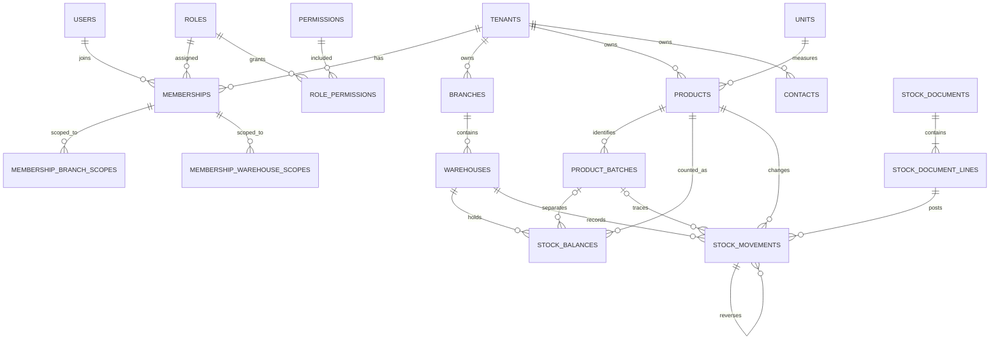

# Database schema plan

Status: initial migration 001_initial_schema has been applied to Supabase. This remains the logical schema reference; future schema changes must use versioned migrations. This plan extends [the product plan](INVENTORY_PRODUCT_PLAN.md), [RBAC plan](RBAC.md), and [edge-case checklist](EDGE_CASES.md). PostgreSQL is authoritative for operational and security data. MongoDB stores only optional flexible product attributes.

## Implementation state

- Physical PostgreSQL objects live in the `stockroom` schema.
- Migration: `api/migrations/001_initial_schema.sql`; status is tracked in `stockroom.schema_migrations`.
- `api/src/db.mjs` connects with the project CA certificate and verified TLS. The API currently exposes a database health route only; tenant CRUD remains gated on authentication and authorization.

## Goals and boundaries

- Isolate every business (tenant) and every tenant-owned record.
- Keep the organization hierarchy fixed: tenant → branch → warehouse.
- Make stock traceable, transaction-safe, and correct under retries and concurrent writes.
- Keep product attributes, stock quantities, prices, costs, permissions, and audit records in PostgreSQL.
- Keep only non-critical, category-specific product specifications in MongoDB. Do not make a MongoDB outage block stock work.
- Model the first release's inventory, purchasing, sales, transfers, counts, returns, reports, and audit needs without adding accounting, payments, manufacturing, serials, bins, or custom workflows.

## Decisions and conventions

1. Use PostgreSQL UUID primary keys (`gen_random_uuid()`). Human-readable SKUs and document numbers are separate values, never database IDs.
2. Use `tenant_id` on every tenant-owned table. Tenant-scoped unique constraints and composite foreign keys prevent accidentally linking records from different tenants.
3. Use `numeric`, never floating point, for quantities and money. Starting suggestion: quantity `numeric(18,3)` and prices/costs `numeric(18,4)`; confirm decimal precision against supported units and currencies before migration.
4. Store instants as `timestamptz`; store business dates as `date` in the tenant's configured timezone. A tenant starts with one currency and timezone.
5. Use explicit status columns and archive records instead of deleting records referenced by history. Posted inventory documents and movements are immutable; corrections are new linked documents/movements.
6. Use fixed, seeded RBAC roles and permissions. No custom role builder in the first release.
7. Keep tenant and location checks in backend services. PostgreSQL row-level security may be added as defense in depth after the app connection and transaction model is defined; it does not replace backend authorization.

## Relationship overview

The diagram shows the core inventory model. Purchasing, sales, reservations, returns, and transfer-specific relationships are described below and added in their delivery stage.

## Tables

### Tenant, identity, and access

| Table | Important columns and rules |
| --- | --- |
| `tenants` | `id`, `name`, `slug`, `status`, `currency_code`, `timezone`, timestamps. `slug` unique; currency/timezone required before operational posting. |
| `users` | `id`, normalized `email`, `password_hash`, `status`, timestamps. Email unique globally; password hashes only, never passwords or reset tokens. |
| `sessions` | `id`, `user_id`, `token_hash`, `expires_at`, `revoked_at`, `last_seen_at`, `created_at`. Index active sessions by user and expiry; store only hashed session tokens. |
| `roles` | Seeded global `id`, stable `key`, `name`. Keys include owner, administrator, branch manager, warehouse operator, sales, purchasing, viewer. |
| `permissions` | Seeded global `id`, stable `key`, description. Keys follow the permission groups in `RBAC.md`. |
| `role_permissions` | `(role_id, permission_id)` primary key. Seed and update through versioned migrations. |
| `memberships` | `id`, `tenant_id`, `user_id`, `role_id`, `status` (`invited`, `active`, `suspended`, `removed`), invitation/activation timestamps. Unique `(tenant_id, user_id)`; composite tenant key for scoped foreign keys. |
| `membership_branch_scopes` | `(tenant_id, membership_id, branch_id)` primary key. Allows one membership to access selected branches. |
| `membership_warehouse_scopes` | `(tenant_id, membership_id, warehouse_id)` primary key. Allows narrower warehouse access. Define whether branch scope implies warehouse scope in authorization code; do not duplicate implied grants into this table. |
| `invitations` | `id`, `tenant_id`, normalized email, `role_id`, token hash, expiry, accepted/revoked timestamps, inviter. One-time token; index active invitations by tenant/email/expiry. |

Role definitions are shared, but each `membership` binds a user to one tenant and role. Location scope is tenant-specific. Resolve membership and scope on the server for each protected operation.

### Branches, warehouses, and catalog

| Table | Important columns and rules |
| --- | --- |
| `branches` | `id`, `tenant_id`, `code`, `name`, optional address fields, `status` (`active`, `archived`), timestamps. Unique `(tenant_id, id)` for composite references; optional code unique per tenant; case-insensitive name unique per tenant while active. |
| `warehouses` | `id`, `tenant_id`, `branch_id`, `code`, `name`, optional address fields, `status`, timestamps. Exactly one parent branch. Composite FK `(tenant_id, branch_id)`; optional code and case-insensitive name unique within branch while active. |
| `units` | Seeded `id`, unique `code`, `name`, `allows_fraction`. Initial units include Piece, Box, Kg, Gram, Litre, Meter. Unit conversion is out of scope initially. |
| `products` | `id`, `tenant_id`, `sku`, `name`, `unit_id`, optional `barcode`, `category`, GST `tax_treatment`, `hsn_code`, `gst_rate`, `cess_rate`, `track_batches`, `status`, timestamps. SKU unique per tenant; barcode unique per tenant when present; GST rates constrained to 0–100. Product catalog is shared by all branches in the tenant. |
| `product_batches` | `id`, `tenant_id`, `product_id`, `batch_number`, optional `manufactured_on`, `expires_on`, `mrp`, status. Unique `(tenant_id, product_id, normalized batch_number)`. Check expiry is not before manufacture. Costs are not stored here because a batch can arrive in multiple receipts at different costs. |
| `contacts` | `id`, `tenant_id`, `name`, optional email/mobile/GSTIN, `status`, timestamps. One record can be both supplier and customer. |
| `contact_roles` | `(tenant_id, contact_id, role)` primary key; `role` is supplier or customer. |
| `contact_addresses` | `id`, `tenant_id`, `contact_id`, address fields, optional label/default flag. Keep optional and allow multiple addresses later without bloating the basic contact form. |

MongoDB's optional product-attributes collection/document uses `{ tenantId, productId, schemaVersion, attributes, updatedAt }`, with a unique compound index on `(tenantId, productId)`. `productId` is the PostgreSQL UUID encoded consistently. The backend verifies the tenant and product in PostgreSQL before accessing this document. There is no cross-database transaction or foreign key; failures must be reported independently and retried safely.

### Stock documents, movement history, and current quantities

| Table | Important columns and rules |
| --- | --- |
| `stock_documents` | `id`, `tenant_id`, `document_type`, `document_number`, `status` (`draft`, `posted`, `cancelled`), `business_date`, optional `warehouse_id`, optional source/destination warehouse IDs for transfers, optional `contact_id`, `idempotency_key`, `version`, creator/poster IDs, timestamps. Unique document number by tenant/type/series; unique idempotency key by tenant when present. Only a posted document can create movements. |
| `stock_document_lines` | `id`, `tenant_id`, `document_id`, `line_number`, `product_id`, optional `product_batch_id`, positive requested/posted quantity, optional acquisition unit cost and MRP, optional linked source line for returns/corrections. Unique `(document_id, line_number)`. Product, batch, and document must belong to the same tenant. |
| `stock_movements` | `id`, `tenant_id`, `document_line_id`, `warehouse_id` (nullable only for explicitly modelled in-transit movements), `product_id`, optional `product_batch_id`, signed `quantity_delta`, `unit_cost`, signed `value_delta`, `business_date`, `posted_at`, `actor_id`, optional `reverses_movement_id`. Append-only; one or more movements per posted line (for example, transfer ship and receive). Unique idempotency/posting key prevents duplicate movements. |
| `stock_balances` | `tenant_id`, `warehouse_id`, `product_id`, optional `product_batch_id`, `quantity_on_hand`, `updated_at`. Unique balance per warehouse/product/batch, including one null-batch row for non-batch products. Use separate partial unique indexes for null and non-null batch IDs if PostgreSQL version does not support `NULLS NOT DISTINCT`. This is a transactional projection, not the audit source. |
| `stock_valuations` | `tenant_id`, `warehouse_id`, `product_id`, `quantity_on_hand`, `inventory_value`, `average_unit_cost`, `updated_at`. Unique `(tenant_id, warehouse_id, product_id)`. Updated in the same transaction as movements/balances; reconcile against the ledger. Candidate policy is moving weighted average per product/warehouse as in the product plan. |
| `stock_reservations` | Planned for sales: `id`, `tenant_id`, `warehouse_id`, `product_id`, optional batch, sales order line, positive reserved quantity, status, timestamps. Unique active reservation per source line/location as needed; reservations reduce available quantity, not on-hand. |
| `document_number_sequences` | `tenant_id`, `document_type`, optional branch/series, `next_value`, formatting settings. Lock/update transactionally when issuing a number; human-readable numbers are not IDs. |

Opening stock is a `stock_document` of type `opening_stock`; later corrections are adjustment documents. The posting transaction validates scope, active location/product, batch rules, dates, unit precision, and available stock; locks/updates the relevant projection rows; writes the document status, ledger movements, balances, valuation, and audit event atomically. A retry with the same idempotency key returns the original posting result.

For batch-tracked products every stock line must identify a batch; for non-batch products the batch reference is null. A batch identity stores manufacture/expiry/MRP, while receipt/opening lines and movements preserve each acquisition cost. The warehouse/product valuation uses moving weighted average; do not treat the batch master as a mutable cost record.

### Operational documents added after the inventory core

These tables keep workflows relational while preserving the shared stock ledger. They are listed now for scope and relationship planning; build them in later migrations after the core is reviewed.

| Table group | Relationships and effect |
| --- | --- |
| `purchase_orders`, `purchase_order_lines` | Tenant-owned order header references supplier and receiving branch/warehouse; lines reference products and ordered quantities/cost estimates. Draft/confirmed/partially received/closed/cancelled lifecycle. Orders alone do not change stock. |
| `purchase_receipts`, `purchase_receipt_lines` | Receipt references supplier and optionally a purchase order; lines reference the ordered line, product, batch, actual quantity and actual unit cost. Posting creates positive movements and is the point stock increases. Partial receipt is supported; over-receipt is rejected initially. |
| `sales_orders`, `sales_order_lines` | Customer and product lines, requested quantities, status and version. Confirmation/reservation is separate from stock dispatch. |
| `dispatches`, `dispatch_lines` | References sales order lines, warehouse, product and batch. Posting creates negative movements and releases the corresponding reservation. Returns reference the original dispatch line. |
| `stock_transfers`, `stock_transfer_lines`, `transfer_receipts` | Header references source and destination warehouses in the same tenant; lines reference product/batch and shipped quantity; receiving records actual quantity and discrepancies. Ship/receive produce separate movements, with in-transit quantity accounted for until receipt or explicit resolution. |
| `stock_counts`, `stock_count_lines` | Count references warehouse and product/batch snapshot; record expected and counted quantities, lock/version and approval status. Posting a variance creates adjustment movements; never overwrite balances directly. |
| `returns`, `return_lines` | Return references original receipt or dispatch line, contact, condition/disposition and accepted quantity. Posting creates linked reversing/return movements; enforce remaining returnable quantity. |
| `audit_events` | `id`, `tenant_id`, actor, action, entity type/id, timestamp, request/correlation ID, safe before/after summary. No passwords, tokens, or secret values. Append-only; permission-checked reads. |

For operational tables, use `tenant_id` in all tenant-owned rows and composite foreign keys for tenant consistency. Do not use a polymorphic `source_type/source_id` as the only relationship from stock movements; movements reference a real stock document line, and specialized documents reference that same stock document/line.

## Required constraints and transaction rules

- Foreign keys from a tenant-owned row include `tenant_id` where practical, e.g. `(tenant_id, branch_id)` → `branches(tenant_id, id)`. This prevents a valid UUID from another tenant being attached accidentally.
- A warehouse belongs to exactly one branch; both are in the same tenant. A product belongs to a tenant and is shared among its branches.
- Quantity deltas and document line quantities have explicit sign rules. Use positive requested quantities on document lines and signed deltas only in the movement ledger.
- Reject negative on-hand/available quantity unless a separately approved workflow explicitly permits it. Never silently clamp or round values.
- Posted documents and movements cannot be edited/deleted. Reversal references the original movement/document and records actor, reason, and timestamp.
- Use `SELECT ... FOR UPDATE` or an equivalent conditional update for stock projection rows inside a transaction. Enforce idempotency with a unique database key, not only a disabled UI button.
- Restrict archive/deactivation when balances, reservations, in-transit stock, or open documents remain. Historical rows retain their references.
- Keep operational audit and stock posting in PostgreSQL. Do not write to MongoDB inside a stock transaction.

## Index plan

Create indexes for actual unique rules, foreign-key joins, list filters, and sort order; validate using representative query plans before production.

| Access pattern | Candidate index |
| --- | --- |
| Tenant product lookup | Unique `(tenant_id, sku)`; optional unique partial `(tenant_id, barcode)`; `(tenant_id, status, name, id)` for catalog listing/search as measured. |
| Branch/warehouse selection | `(tenant_id, status, name)` on branches; `(tenant_id, branch_id, status, name)` on warehouses; unique optional codes at their documented scope. |
| Stock on hand by location | Unique `(tenant_id, warehouse_id, product_id, product_batch_id)` with null-safe strategy; `(tenant_id, product_id, warehouse_id)` for product drill-down. |
| Product movement history | `(tenant_id, warehouse_id, product_id, posted_at DESC, id DESC)`; `(tenant_id, document_line_id)` unique or selective to support idempotent posting. |
| Expiry checks | Partial `(tenant_id, expires_on, product_id)` for active tracked batches where expiry is not null; join to positive warehouse balance. |
| Documents and reports | `(tenant_id, document_type, status, business_date DESC, id)` and location/date-specific indexes based on real screens. |
| Membership scope | Unique membership/location scope keys beginning with `(tenant_id, membership_id)` and reverse indexes by location for access checks. |
| Audit timeline | `(tenant_id, occurred_at DESC, id DESC)` and selective entity lookup `(tenant_id, entity_type, entity_id, occurred_at DESC)`. |

Do not add an index to every column. Include tenant scope in tenant-owned lookups, paginate large movement histories, fetch only displayed fields, and avoid computing dashboard totals by scanning the complete ledger.

## MongoDB collection and failure boundary

The only planned MongoDB collection is `product_attributes` for optional flexible specifications. Index `{ tenantId: 1, productId: 1 }` uniquely and add further indexes only for a real attribute filter. Core product fields remain in PostgreSQL. MongoDB failure must not block product reads/writes that do not touch those attributes, nor any stock operation. Save/report core and attribute outcomes separately; retry attribute writes idempotently. Backups and restore checks must detect orphaned tenant/product references.

## Migration and delivery order

1. Review this logical model and confirm decimal precision, tenant currency/timezone, costing policy, and transfer posting lifecycle.
2. Add PostgreSQL migrations for tenant identity, memberships/RBAC, branches, warehouses, units, products, contacts, and indexes.
3. Add batches, stock documents/lines, movements, balances, valuation, idempotency, and audit in the same stock-core milestone.
4. Connect setup, location, product, and opening-stock screens to backend services; validate tenant isolation and atomic posting before real data is used.
5. Add purchasing/receipts, then sales/reservations/dispatch, transfers, returns, counts, and reports in separate migrations.
6. Add MongoDB product attributes only after PostgreSQL product and tenant authorization work; verify the partial-failure behavior.

This file is a design proposal, not evidence of a deployed schema. Before migrations, confirm the costing and transfer rules against real workflows and inspect the target PostgreSQL version and backend repository conventions.
